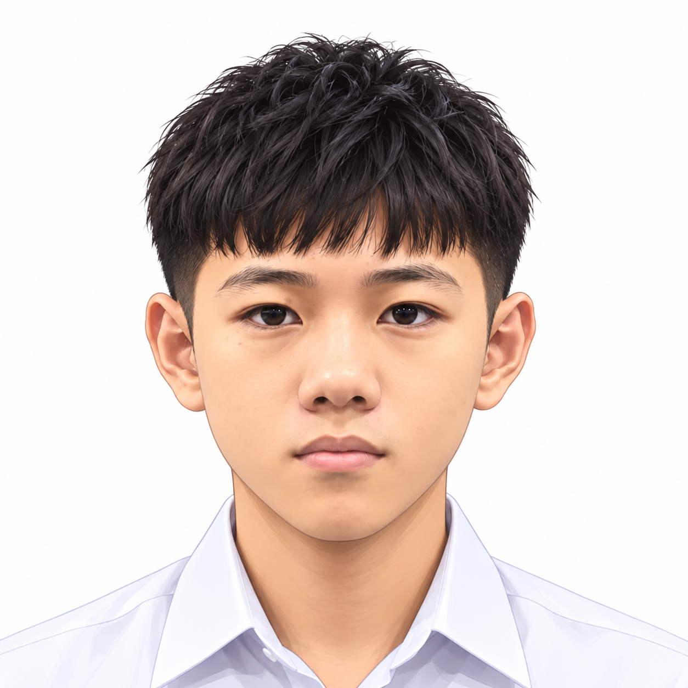

# 👋 Hi, I'm Victor Chun Wai Xiang

  

🎓 First-year Data Engineering student at Universiti Teknologi Malaysia (UTM).

🌱 Exploring the world of data, AI, and automation while building my technical skills one project at a time.

## 🔍 Interests

- 📊 Data Engineering & Analytics
- 🤖 Artificial Intelligence & Machine Learning
- ⚙️ Automation & Scripting
- 🧠 Exploring new technologies and ideas

## 📚 Currently Learning

- 💻 Programming and problem-solving
- 🗃️ Data processing and management
- 📈 Turning data into useful insights

## 🎯 Goals

- 🛠️ Build practical, hands-on projects.
- 💡 Learn how to solve real-world problems with data.
- 🚀 Grow my technical skills and portfolio.
- 📝 Document my learning journey on GitHub.

## 🌱 My Philosophy

> Learning by building, one step at a time.
